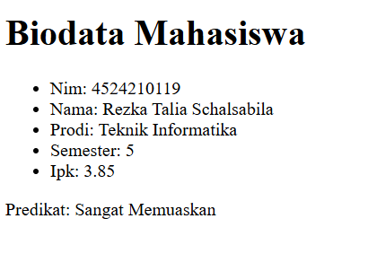
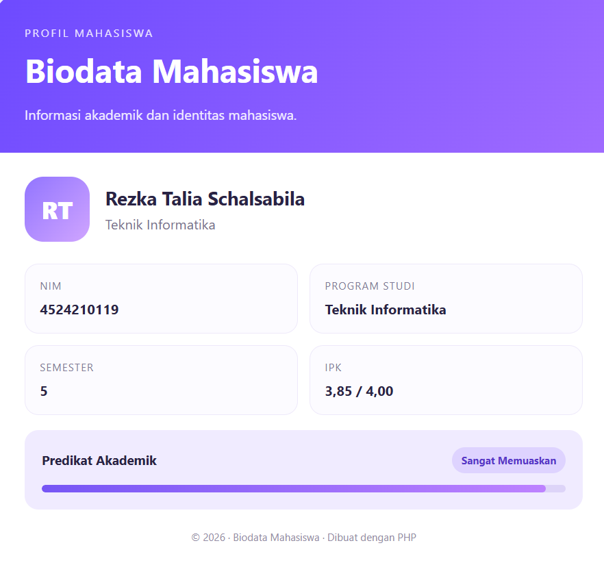
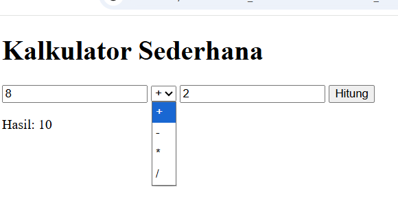
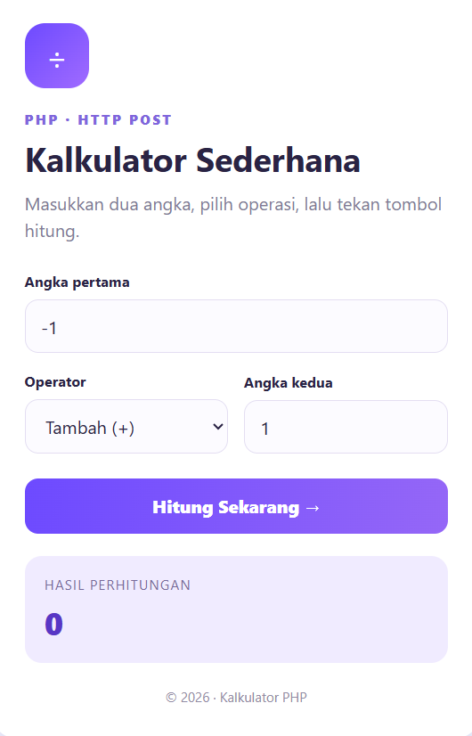

# 📘 Laporan Praktikum Pertemuan 1 & 2

🧑‍🎓 **Rezka Talia Schalsabila — 4524210119**

## 🏫 Praktikum Pemrograman Berbasis Web

Repository ini berisi hasil pengerjaan praktikum mata kuliah **Pemrograman Berbasis Web (PBW)** pada Pertemuan 1 & 2. Praktikum berfokus pada dasar pemrograman PHP, pengolahan input, penggunaan metode HTTP, serta pembuatan halaman web sederhana.

## ✨ Daftar Praktikum

### 1. 👩‍🎓 Biodata Mahasiswa

Program untuk menampilkan informasi identitas dan akademik mahasiswa, meliputi:

- NIM
- Nama mahasiswa
- Program studi
- Semester
- IPK
- Predikat akademik

**Pengembangan tampilan:** Biodata dibuat dalam dua versi, yaitu tampilan sederhana dan tampilan modern dengan desain responsif, kartu informasi, serta indikator predikat akademik.

### 2. 🧮 Kalkulator Sederhana

Program kalkulator untuk melakukan operasi aritmatika berdasarkan dua angka dan operator yang dipilih pengguna.

**Fitur utama:**
- Memasukkan dua angka.
- Memilih operasi penjumlahan, pengurangan, perkalian, atau pembagian.
- Memproses input dan menampilkan hasil perhitungan.
- Menggunakan metode HTTP POST pada versi PHP.
- Menampilkan hasil dengan antarmuka yang lebih modern pada versi pengembangan.

## 🛠️ Teknologi yang Digunakan

- **PHP** — pemrosesan data dan logika program.
- **HTML** — struktur halaman web.
- **CSS** — pengaturan tampilan dan desain antarmuka.
- **JavaScript** — digunakan jika diperlukan pada implementasi program.
- **XAMPP** — lingkungan pengembangan lokal untuk menjalankan PHP dan Apache.
- **Visual Studio Code** — editor kode.

## 📂 Struktur Folder

```text
Pertemuan1&2/
├── Biodata/
│   └── File program biodata
├── Kalkulator/
│   └── File program kalkulator
└── README.md
```

*Catatan: Struktur di atas merupakan gambaran umum. Sesuaikan nama folder dan file dengan struktur yang sebenarnya di repository.*

## 🚀 Cara Menjalankan Program

### 1. Persiapan

Pastikan XAMPP sudah terpasang dan Apache aktif.

### 2. Menjalankan Biodata

1. Letakkan folder praktikum di dalam direktori `htdocs`.
2. Buka browser.
3. Akses file biodata melalui alamat localhost sesuai nama folder dan file yang digunakan.

Contoh:

```text
http://localhost/4524210119_Rezka-Talia-Schalsabila_PBW_A/Pertemuan1%262/Biodata/
```

### 3. Menjalankan Kalkulator

1. Pastikan Apache berjalan di XAMPP.
2. Buka browser.
3. Akses file kalkulator melalui alamat localhost sesuai lokasi file program.

Contoh:

```text
http://localhost/4524210119_Rezka-Talia-Schalsabila_PBW_A/Pertemuan1%262/Kalkulator/
```

*Catatan: Sesuaikan URL dengan nama folder dan file yang sebenarnya. Jika nama folder berbeda, alamat localhost juga perlu disesuaikan.*

## 📸 Hasil Praktikum

### Biodata Mahasiswa — Tampilan Sederhana



### Biodata Mahasiswa — Tampilan Modern



### Kalkulator — Tampilan Sederhana



### Kalkulator — Tampilan Modern




## 🎯 Tujuan Praktikum

- Memahami dasar pemrograman PHP.
- Memahami penggunaan input dan output pada halaman web.
- Mempraktikkan pengolahan data menggunakan metode HTTP.
- Membuat program biodata dan kalkulator sederhana.
- Mengembangkan tampilan serta fungsionalitas program.

## 📝 Kesimpulan

Melalui praktikum Pertemuan 1 & 2, dibuat dua program web sederhana, yaitu Biodata Mahasiswa dan Kalkulator Sederhana. Praktikum ini menjadi dasar untuk memahami struktur halaman web, pemrosesan data menggunakan PHP, dan pengembangan tampilan antarmuka.

---

**Mata Kuliah:** Pemrograman Berbasis Web (PBW)  
**Nama:** Rezka Talia Schalsabila  
**NIM:** 4524210119
