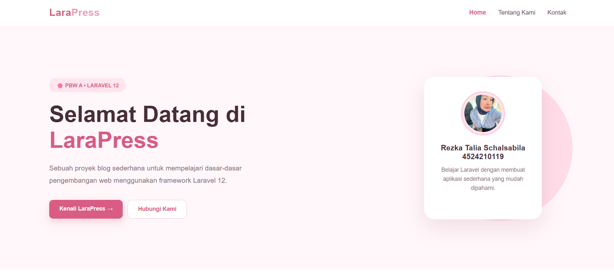
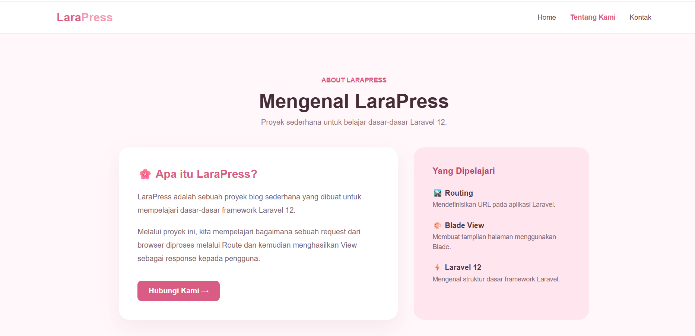
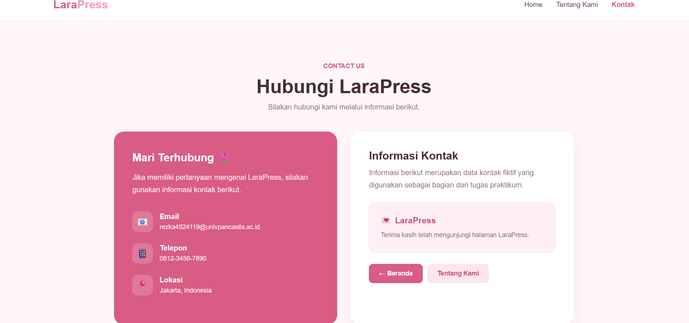

# 📘 Laporan Praktikum Pertemuan 3

**🧑‍🎓 Rezka Talia Schalsabila — 4524210119**

# 🌸 LaraPress — Website Profil Sederhana dengan Laravel 12

LaraPress merupakan proyek website sederhana yang dibuat untuk mempelajari dasar-dasar framework Laravel 12. Website ini menampilkan informasi profil proyek melalui beberapa halaman, yaitu Home, Tentang Kami, dan Kontak, dengan desain bernuansa merah muda yang responsif dan menarik.

## ✨ Fitur Utama

- 🏠 **Halaman Home** — Menampilkan sambutan dan pengenalan LaraPress.
- 🌷 **Halaman Tentang Kami** — Menjelaskan proyek dan materi yang dipelajari.
- 📩 **Halaman Kontak** — Menampilkan informasi kontak.
- 🎨 **Desain Modern** — Tampilan dengan kombinasi warna merah muda dan putih.
- 🔗 **Navigasi Antarhalaman** — Memudahkan pengguna berpindah halaman melalui menu navigasi.
- 📱 **Tampilan Responsif** — Dirancang agar nyaman dilihat pada berbagai ukuran layar.

## 🛠️ Teknologi yang Digunakan

- **Laravel 12** — Framework aplikasi web.
- **PHP** — Bahasa pemrograman backend.
- **Blade** — Template engine Laravel untuk membuat tampilan halaman.
- **HTML** — Struktur halaman website.
- **CSS** — Mengatur tampilan dan desain website.
- **Composer** — Mengelola dependensi PHP.

## 📋 Materi yang Dipelajari

1. **Routing** — Menentukan URL dan halaman yang dapat diakses pengguna.
2. **Blade View** — Membuat tampilan halaman menggunakan template Blade.
3. **Request dan Response** — Memahami alur permintaan dari browser hingga menghasilkan halaman web.
4. **Struktur Project Laravel** — Mengenal folder dan file utama dalam Laravel.

## 🚀 Instalasi dan Menjalankan Project

### 1. Masuk ke Folder Project

```bash
cd LaraPress
```

### 2. Install Dependensi

```bash
composer install
npm install
```

### 3. Konfigurasi Environment

Pastikan file `.env` tersedia. Jika belum, salin file contoh:

```bash
copy .env.example .env
```

Kemudian buat application key:

```bash
php artisan key:generate
```

### 4. Jalankan Website

```bash
php artisan serve
```

Buka browser dan akses:

`http://127.0.0.1:8000`

Jika ingin menjalankan proses frontend saat pengembangan, gunakan terminal lain:

```bash
npm run dev
```

## 📸 Hasil Praktikum

### Halaman Home LaraPress



### Halaman Tentang Kami



### Halaman Kontak




## 👩‍💻 Identitas Mahasiswa

- **Nama:** Rezka Talia Schalsabila
- **NIM:** 4524210119
- **Program Studi:** Teknik Informatika
- **Mata Kuliah:** Pemrograman Berbasis Web (PBW)
- **Praktikum:** Pertemuan 3

---

<p align="center">Dibuat dengan ❤️ untuk Praktikum Pemrograman Berbasis Web</p>
