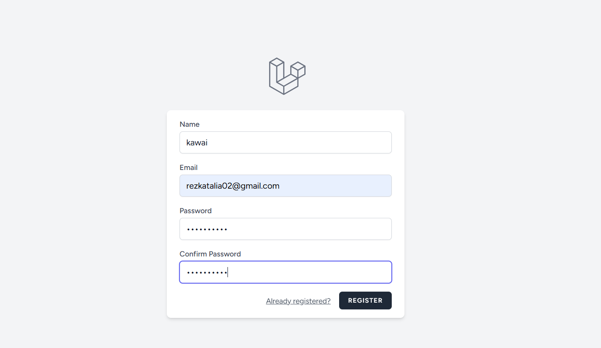
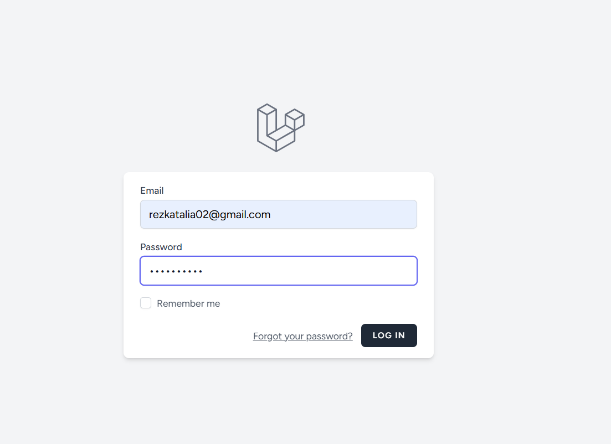
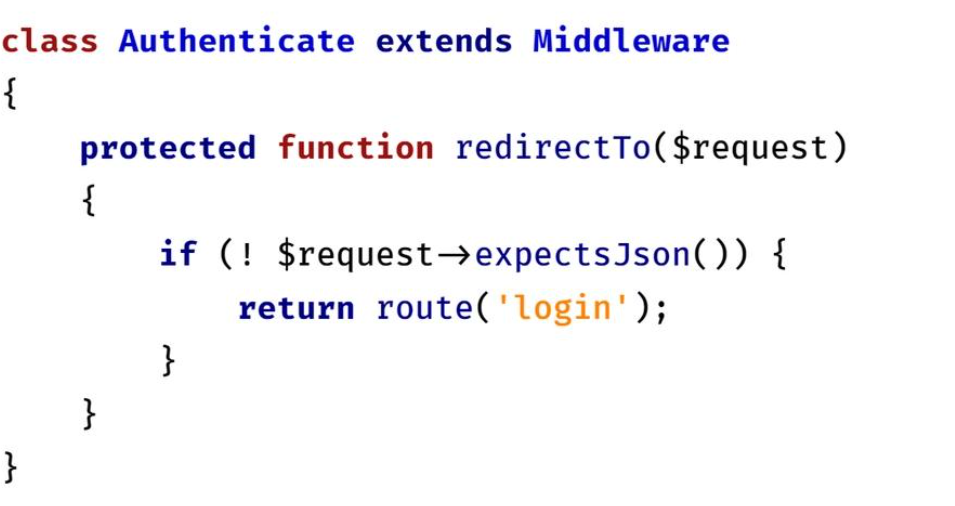

# Praktikum 4 — Autentikasi Login Laravel

**Nama:** Rezka Talia Schalsabila  
**NIM:** 4524210119  
**Mata Kuliah:** Pemrograman Berbasis Web A

## 📌 Deskripsi Praktikum

Praktikum ini membahas penerapan sistem autentikasi pada aplikasi LaraPress menggunakan Laravel Breeze. Fitur autentikasi digunakan untuk memverifikasi identitas pengguna melalui proses registrasi dan login.

## 🎯 Tujuan Praktikum

- Memahami konsep autentikasi dan otorisasi.
- Menginstal Laravel Breeze.
- Membuat fitur Register, Login, dan Logout.
- Memahami penggunaan Session, Cookie, dan Password Hashing.
- Melindungi rute pengelolaan postingan menggunakan middleware `auth`.

## 🛠️ Teknologi yang Digunakan

- Laravel 12
- PHP
- Laravel Breeze
- Blade dan Alpine.js
- Tailwind CSS
- Composer
- Node.js dan NPM
- MySQL (jika menggunakan database MySQL)

## ⚙️ Langkah-Langkah Praktikum

### 1. Instalasi Laravel Breeze

```bash
composer require laravel/breeze --dev
php artisan breeze:install
```

Pada proses instalasi, pilih Blade with Alpine, nonaktifkan dukungan dark mode, lalu pilih testing framework sesuai instruksi praktikum.

### 2. Instalasi Dependensi Frontend

```bash
npm install
npm run dev
```

### 3. Migrasi Database

```bash
php artisan migrate
```

### 4. Menjalankan Aplikasi

```bash
php artisan serve
```

Buka alamat aplikasi yang ditampilkan terminal. Selanjutnya, uji fitur Register dan Login.

### 5. Memeriksa File Autentikasi

File yang dipelajari meliputi:

- `routes/web.php`
- `routes/auth.php`
- `app/Http/Controllers/Auth/`
- `resources/views/auth/`

### 6. Melindungi Rute CRUD

Rute untuk membuat, mengedit, memperbarui, dan menghapus postingan perlu dilindungi menggunakan middleware `auth`.

Contoh:

```php
Route::middleware('auth')->group(function () {
    // Letakkan rute CRUD postingan di sini.
});
```

## 📸 Hasil Praktikum

### Halaman Register



### Halaman Login



### Halaman LaraPress


### Halaman Setelah Login


### Pengujian Rute Terproteksi



## 📝 Kesimpulan

Pada praktikum ini, sistem autentikasi ditambahkan ke aplikasi LaraPress menggunakan Laravel Breeze. Fitur registrasi dan login membantu memverifikasi identitas pengguna, sedangkan middleware `auth` digunakan untuk membatasi akses ke rute tertentu agar hanya dapat diakses oleh pengguna yang telah login.
