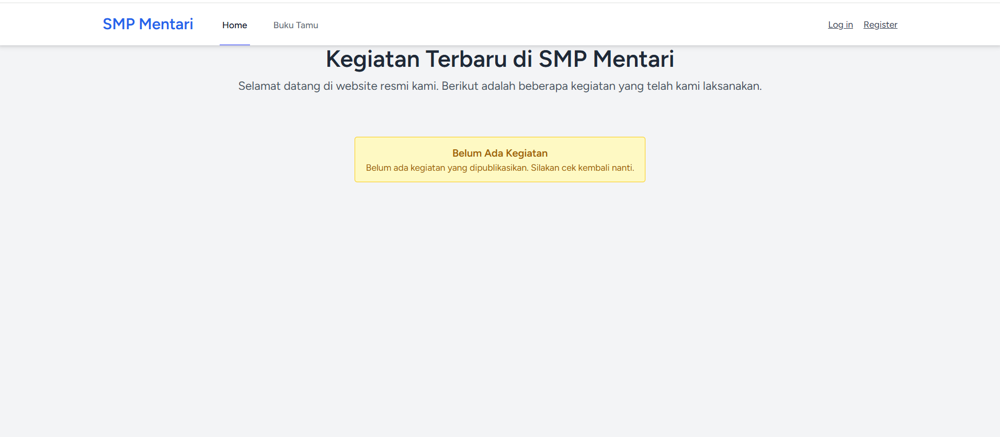
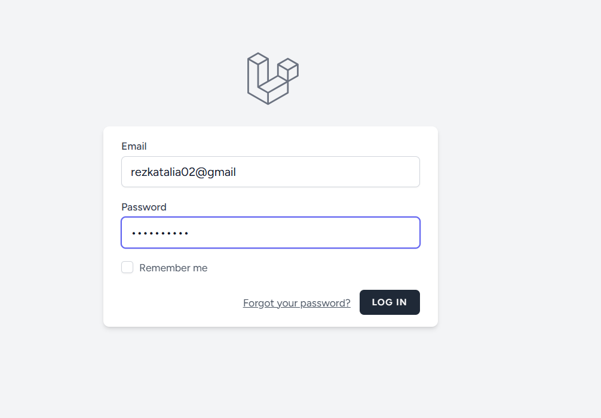
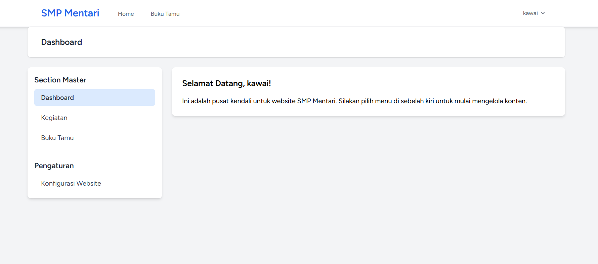
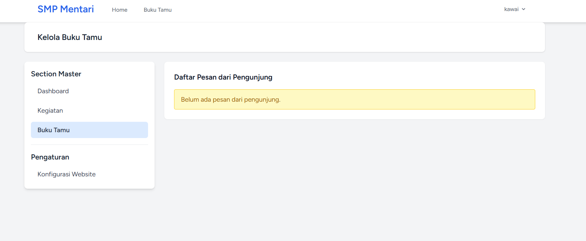
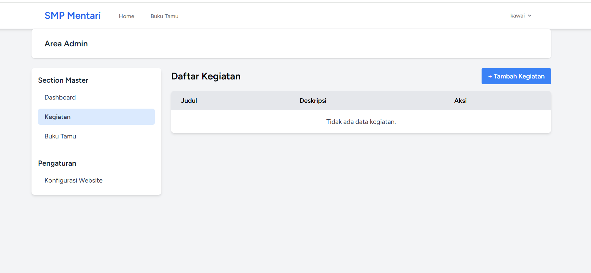
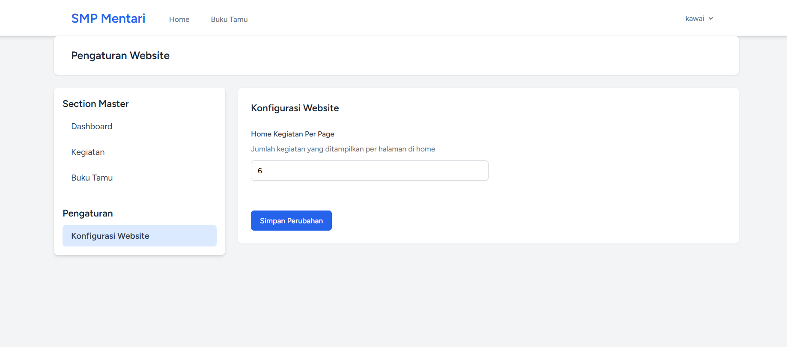

# Praktikum 5 — Manajemen Konten & Buku Tamu Laravel

**Nama:** Rezka Talia Schalsabila  
**NIM:** 4524210119  
**Mata Kuliah:** Pemrograman Berbasis Web A

---

## 📌 Deskripsi Praktikum

Praktikum ini berfokus pada pembangunan fitur **manajemen konten (CRUD Kegiatan)** dan **Buku Tamu** pada aplikasi Laravel. Selain itu, praktikum ini juga menerapkan sistem **pengaturan website yang dinamis** menggunakan database, serta integrasi **layout admin** yang terstruktur.

---

## 🎯 Tujuan Praktikum

- Memahami dan mengimplementasikan operasi **CRUD** (*Create, Read, Update, Delete*) pada Laravel.
- Membuat dan mengelola relasi antar tabel database menggunakan **Migration**.
- Menerapkan konsep **Model, Controller, dan View (MVC)** secara lebih kompleks.
- Membuat sistem **pengaturan website (Settings)** yang dapat dikonfigurasi melalui panel admin.
- Mengintegrasikan fitur **Buku Tamu** untuk interaksi pengunjung.
- Menggunakan **Laravel Breeze** untuk autentikasi dan melindungi rute admin.

---

## 🛠️ Teknologi yang Digunakan

- **Laravel 12**
- **PHP**
- **Laravel Breeze**
- **Blade & Tailwind CSS**
- **MySQL / SQLite**
- **Vite**

---

## 🚀 Langkah-Langkah Praktikum

### 1. Persiapan Environment & Inisialisasi Project

Membuat project Laravel baru dengan nama `SMP-Mentari`, menginstal **Laravel Breeze** untuk sistem autentikasi, dan menjalankan migrasi database bawaan.

```bash
composer create-project laravel/laravel SMP-Mentari
cd SMP-Mentari
composer require laravel/breeze --dev
php artisan breeze:install blade
npm install
php artisan migrate
```

---

### 2. Skema Database & Migrasi

Membuat migrasi untuk tabel `pesan_tamus` (Buku Tamu), `kegiatans` (Kegiatan), dan `settings` (Pengaturan).

```bash
php artisan make:migration create_pesan_tamus_table
php artisan make:model Kegiatan -m
php artisan make:model Setting -m
```

---

### 3. Model & Controller

Membuat **Model** `Kegiatan`, `PesanTamu`, dan `Setting` beserta **Controller** untuk mengelola logika aplikasi.

- `PageController` — untuk halaman publik
- `KegiatanController` — CRUD Kegiatan
- `PesanTamuController` — Buku Tamu
- `DashboardController` — Halaman Admin
- `SettingController` — Pengaturan Website

---

### 4. Routing

Mendefinisikan **rute publik** dan **rute terproteksi (admin)** di `routes/web.php`.

```php
// Rute Publik
Route::get('/', [PageController::class, 'home'])->name('home');
Route::get('/bukutamu', [PesanTamuController::class, 'index'])->name('bukutamu.index');
Route::post('/bukutamu', [PesanTamuController::class, 'store'])->name('bukutamu.store');

// Rute Terproteksi (Admin)
Route::middleware('auth')->group(function () {
    Route::get('/dashboard', [DashboardController::class, 'index'])->name('dashboard');
    Route::resource('kegiatan', KegiatanController::class);
    Route::get('/admin/bukutamu', [PesanTamuController::class, 'adminIndex'])->name('bukutamu.admin.index');
    Route::delete('/admin/bukutamu/{pesanTamu}', [PesanTamuController::class, 'destroy'])->name('bukutamu.admin.destroy');
    Route::get('/settings', [SettingController::class, 'index'])->name('settings.index');
    Route::put('/settings', [SettingController::class, 'update'])->name('settings.update');
});
```

---

### 5. Views (Tampilan)

Membuat tampilan menggunakan **Blade template** dengan layout admin yang terstruktur.

- **Master Layout Admin:** `layouts/admin.blade.php`
- **Partials:** `header.blade.php`, `footer.blade.php`
- **Halaman Dashboard:** `dashboard.blade.php`
- **Halaman Pengaturan:** `admin/settings/index.blade.php`
- **Halaman Buku Tamu (Admin):** `admin/bukutamu/index.blade.php`
- **Halaman Kegiatan (CRUD):** `kegiatan/index.blade.php`, `create.blade.php`, `edit.blade.php`
- **Halaman Utama (Home):** `home.blade.php`

---

### 6. Eksekusi & Testing

Menjalankan server lokal dan Vite untuk pengembangan.

```bash
composer dev
```

---

## 📸 Dokumentasi Tampilan

Berikut adalah beberapa tampilan antarmuka dari aplikasi yang telah dibuat:

### 1. Halaman Utama (Home)

Menampilkan daftar kegiatan terbaru. Jika belum ada data, akan muncul pesan *"Belum Ada Kegiatan"*.



### 2. Halaman Register

Halaman pendaftaran akun baru menggunakan **Laravel Breeze**.


### 2. Halaman Login

Halaman Login menggunakan **Laravel Breeze**.




### 3. Halaman Dashboard Admin

Halaman utama panel admin setelah login, menampilkan sapaan kepada pengguna.



### 4. Halaman Kelola Buku Tamu

Halaman untuk melihat dan menghapus pesan dari pengunjung.



### 5. Halaman Daftar Kegiatan

Halaman admin untuk mengelola data kegiatan (CRUD).



### 6. Halaman Pengaturan Website

Halaman untuk mengonfigurasi pengaturan situs, seperti jumlah kegiatan per halaman.



---

## ✅ Kesimpulan

Praktikum ini berhasil mengimplementasikan fitur **manajemen konten** dan **Buku Tamu** pada aplikasi Laravel. Dengan memanfaatkan konsep **MVC**, **migrasi database**, dan **Laravel Breeze**, aplikasi dapat berjalan dengan baik. Fitur **pengaturan dinamis** juga memungkinkan admin untuk mengubah konfigurasi website tanpa perlu mengubah kode secara langsung.

---


> 📝 **Catatan:** Jangan lupa untuk menaruh file screenshot di folder `screenshots/` agar gambar dapat tampil di README GitHub.
