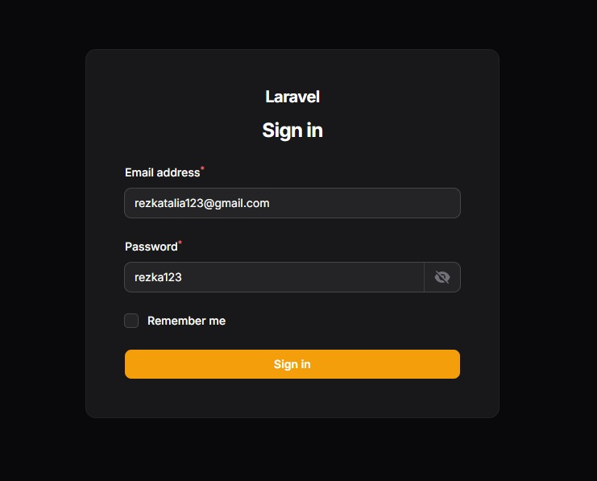
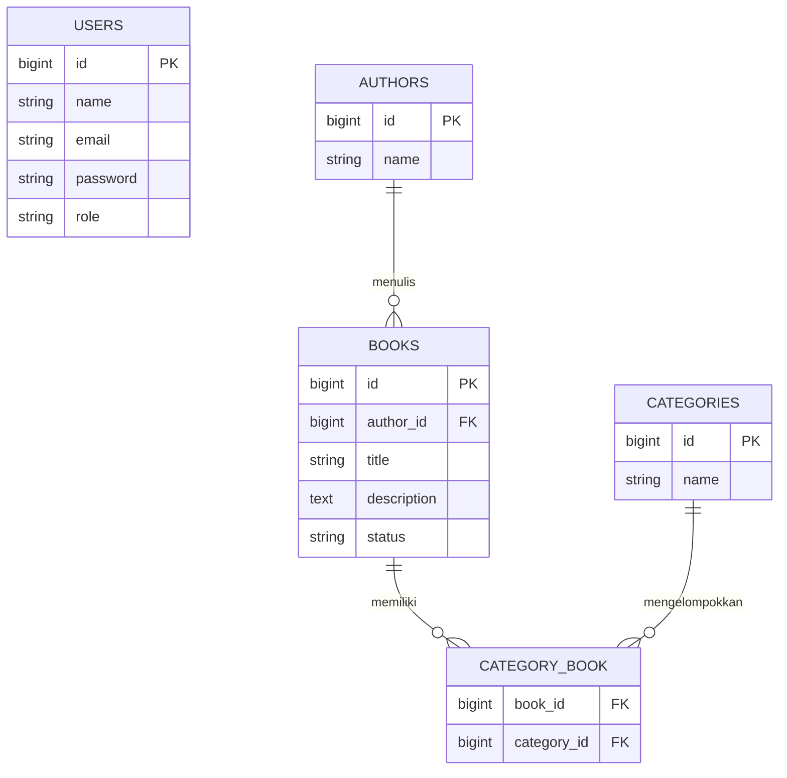
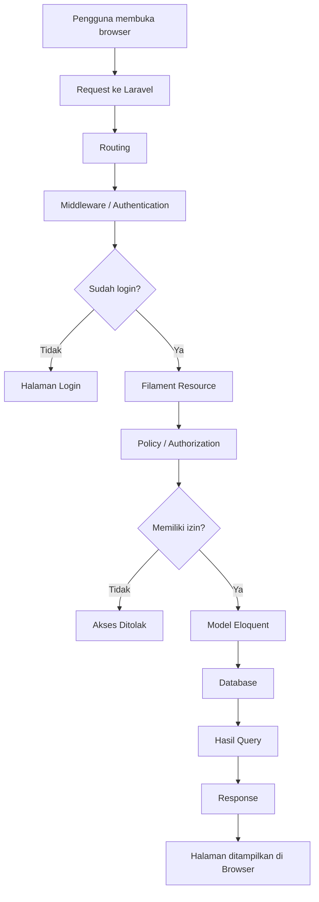

# 📚 LAPORAN PRAKTIKUM PERTEMUAN 6, 7, DAN 8
## Implementasi, Kustomisasi, dan Analisis Aplikasi Manajemen Buku Menggunakan Laravel dan Filament

**Nama:** Rezka Talia Schalsabila  
**NIM:** 4524210119  
**Program Studi:** Teknik Informatika  
**Mata Kuliah:** Pemrograman Berbasis Web (PBW)  
**Framework:** Laravel 12  
**Admin Panel:** Filament  

---

## 📖 Deskripsi Proyek

Aplikasi Manajemen Buku merupakan sebuah aplikasi berbasis web yang dikembangkan menggunakan framework Laravel dan Filament.

Aplikasi ini dibuat sebagai bentuk penerapan materi praktikum Pemrograman Berbasis Web, khususnya dalam mempelajari pengelolaan data menggunakan Laravel serta pembuatan dashboard administrasi menggunakan Filament.

Aplikasi ini memiliki fungsi utama untuk mengelola data buku, data penulis, kategori buku, serta status ketersediaan buku. Selain itu, aplikasi juga menerapkan sistem hak akses pengguna berdasarkan role sehingga setiap pengguna memiliki batasan akses sesuai dengan perannya.

Praktikum ini dibagi menjadi tiga tahapan utama:

1. **Pertemuan 6 – Implementasi Dasar:** Membuat aplikasi manajemen buku menggunakan Laravel dan Filament, termasuk fitur CRUD, pencarian, dan filter.
2. **Pertemuan 7 – Kustomisasi dan Pengembangan:** Menambahkan deskripsi buku, role-based access control, dashboard widget, serta kategori buku.
3. **Pertemuan 8 – Analisis dan Dokumentasi:** Membahas arsitektur aplikasi, diagram ERD, perbandingan Filament dengan pendekatan tradisional, serta refleksi pembelajaran.

---

# 📑 DAFTAR ISI

1. [Informasi Proyek](#-informasi-proyek)
2. [Tujuan Praktikum](#-tujuan-praktikum)
3. [Teknologi yang Digunakan](#-teknologi-yang-digunakan)
4. [Persyaratan Sistem](#-persyaratan-sistem)
5. [Instalasi dan Konfigurasi](#-instalasi-dan-konfigurasi)
6. [Pertemuan 6 – Implementasi Dasar](#-pertemuan-6--implementasi-dasar)
7. [Pertemuan 7 – Kustomisasi dan Pengembangan](#-pertemuan-7--kustomisasi-dan-pengembangan)
8. [Pertemuan 8 – Analisis dan Dokumentasi](#-pertemuan-8--analisis-dan-dokumentasi)
9. [Arsitektur dan Alur Aplikasi](#-arsitektur-dan-alur-aplikasi)
10. [Perbandingan Filament dan CRUD Manual](#-perbandingan-filament-dan-crud-manual)
11. [Refleksi Pembelajaran](#-refleksi-pembelajaran)
12. [Kesimpulan](#-kesimpulan)

---

# 🎯 INFORMASI PROYEK

| Keterangan | Deskripsi |
|---|---|
| Nama Proyek | Aplikasi Manajemen Buku |
| Nama Mahasiswa | Rezka Talia Schalsabila |
| NIM | 4524210119 |
| Framework | Laravel 12 |
| Admin Panel | Filament |
| Bahasa Pemrograman | PHP |
| Database | SQLite / MySQL (sesuai konfigurasi) |
| Frontend | Blade, Tailwind CSS |
| Asset Bundler | Vite |

## Tujuan Praktikum

Tujuan dari praktikum ini adalah:

- Memahami dasar penggunaan framework Laravel.
- Memahami penggunaan Filament untuk membuat panel administrasi.
- Mengimplementasikan operasi CRUD (Create, Read, Update, Delete).
- Memahami penggunaan migration, model, factory, dan seeder.
- Mengimplementasikan pencarian dan filter data.
- Memahami penerapan role-based access control.
- Membuat dashboard widget untuk menampilkan informasi data.
- Memahami relasi antar tabel menggunakan Eloquent ORM.
- Menganalisis alur kerja aplikasi Laravel dari request hingga response.

---

# 🛠️ TEKNOLOGI YANG DIGUNAKAN

| Teknologi | Kegunaan |
|---|---|
| PHP 8.2 | Bahasa pemrograman backend |
| Laravel 12 | Framework pengembangan aplikasi |
| Filament | Pembuatan admin panel |
| SQLite / MySQL | Sistem manajemen database |
| Blade | Template tampilan |
| Tailwind CSS | Styling antarmuka |
| Vite | Pengelolaan asset frontend |
| Composer | Dependency manager PHP |
| NPM | Dependency manager JavaScript |
| Git & GitHub | Version control dan penyimpanan repository |

---

# 💻 PERSYARATAN SISTEM

Sebelum menjalankan aplikasi, pastikan perangkat sudah memiliki:

- PHP minimal 8.2.
- Composer.
- Node.js dan NPM.
- Database SQLite atau MySQL.
- Web browser.
- Visual Studio Code.
- Git.

---

# ⚙️ INSTALASI DAN KONFIGURASI

## 1. Clone Repository

Clone repository GitHub menggunakan perintah:

```bash
git clone https://github.com/rezka4524119/4524210119_Rezka-Talia-Schalsabila_PBW_A.git
```

Masuk ke folder proyek:

```bash
cd 4524210119_Rezka-Talia-Schalsabila_PBW_A/4524210119_Rezka-Talia-Schalsabila_PBW_A/Pertemuan6,7,8
```

## 2. Install Dependency

Install dependency Laravel menggunakan Composer:

```bash
composer install
```

Install dependency frontend:

```bash
npm install
```

## 3. Konfigurasi Environment

Salin file `.env.example` menjadi `.env`.

Windows CMD:

```bash
copy .env.example .env
```

Windows PowerShell:

```powershell
Copy-Item .env.example .env
```

Linux / macOS:

```bash
cp .env.example .env
```

Generate application key:

```bash
php artisan key:generate
```

## 4. Konfigurasi Database

Sesuaikan konfigurasi database pada file `.env`.

Contoh konfigurasi SQLite:

```env
DB_CONNECTION=sqlite
```

Pastikan file database tersedia di folder `database` dengan nama `database.sqlite`.

Jika belum tersedia, buat file kosong bernama `database.sqlite`.

## 5. Jalankan Migration

Untuk membuat tabel database:

```bash
php artisan migrate
```

Jika ingin menjalankan seluruh migration sekaligus dengan seeder pada database lokal yang boleh dihapus:

```bash
php artisan migrate:fresh --seed
```

**Catatan:** Perintah `migrate:fresh` akan menghapus seluruh tabel yang ada sebelum membuatnya kembali. Jangan gunakan pada database yang berisi data penting.

## 6. Build Frontend

Jalankan perintah:

```bash
npm run build
```

Perintah tersebut digunakan untuk membangun asset frontend agar dapat digunakan oleh aplikasi Laravel.

## 7. Jalankan Aplikasi

Jalankan server Laravel:

```bash
php artisan serve
```

Aplikasi dapat diakses melalui:

```text
http://127.0.0.1:8000
```

Untuk membuka halaman admin Filament:

```text
http://127.0.0.1:8000/admin
```

---

# 📘 PERTEMUAN 6 – IMPLEMENTASI DASAR

## 1. Penjelasan Implementasi

Pada pertemuan 6 dilakukan implementasi dasar aplikasi manajemen buku menggunakan Laravel dan Filament.

Filament digunakan untuk membantu pembuatan halaman administrasi sehingga pengelolaan data dapat dilakukan melalui antarmuka yang lebih praktis.

Implementasi ini berfokus pada pengelolaan data buku, mulai dari menambahkan data, melihat daftar buku, melakukan pencarian, hingga menggunakan fitur filter.

## 2. Implementasi Admin Panel

Admin panel merupakan halaman khusus yang digunakan oleh administrator untuk mengelola data aplikasi.

Melalui admin panel, pengguna yang memiliki hak akses dapat masuk dan melakukan pengelolaan data buku.

### 📸 Screenshot 1 – Login Admin



## 3. Dashboard Filament

Dashboard merupakan halaman utama admin panel yang menjadi tempat pengguna mengakses berbagai menu pengelolaan aplikasi.

Pada halaman ini terdapat navigasi menuju fitur-fitur administrasi seperti pengelolaan buku dan data lainnya.

### 📸 Screenshot 2 – Dashboard Filament

**Cara mengambil screenshot:**

1. Login ke admin panel.
2. Pastikan halaman dashboard sudah terbuka.
3. Ambil screenshot halaman dashboard secara keseluruhan.

**Simpan gambar dengan nama:** `02-dashboard-filament.png`


## 4. Pengelolaan Data Buku (CRUD)

Fitur CRUD merupakan fitur utama dalam aplikasi manajemen buku.

CRUD terdiri dari empat operasi:

- **Create:** Menambahkan data buku baru.
- **Read:** Menampilkan data buku.
- **Update:** Mengubah informasi buku.
- **Delete:** Menghapus data buku.

Melalui Filament, proses pengelolaan data dapat dilakukan menggunakan halaman administrasi tanpa harus membuat seluruh tampilan CRUD secara manual.

### 📸 Screenshot 3 – List Books

**Cara mengambil screenshot:**

1. Masuk ke dashboard Filament.
2. Pilih menu Books.
3. Pastikan daftar buku sudah muncul.
4. Tampilkan beberapa data buku hasil seeder.
5. Ambil screenshot tabel daftar buku.

**Simpan gambar dengan nama:** `03-list-books.png`


### 📸 Screenshot 4 – Form Create Book

**Cara mengambil screenshot:**

1. Masuk ke menu Books.
2. Klik tombol Create atau Create Book.
3. Pastikan formulir penambahan buku terbuka.
4. Ambil screenshot formulir tersebut.

**Simpan gambar dengan nama:** `04-create-book.png`


## 5. Fitur Pencarian Buku

Fitur pencarian digunakan untuk mempermudah administrator menemukan data buku berdasarkan informasi yang tersedia.

Dengan fitur ini, administrator tidak perlu mencari data secara manual satu per satu pada tabel.

### 📸 Screenshot 5 – Search Book

**Cara mengambil screenshot:**

1. Masuk ke halaman List Books.
2. Cari kolom pencarian.
3. Masukkan judul atau informasi buku yang ingin dicari.
4. Pastikan hasil pencarian sesuai dengan kata kunci.
5. Ambil screenshot hasil pencarian.

**Simpan gambar dengan nama:** `05-search-book.png`


## 6. Fitur Filter Buku

Filter digunakan untuk menyaring data berdasarkan kriteria tertentu, misalnya status ketersediaan buku.

Fitur ini membantu administrator menampilkan data yang lebih spesifik sesuai kebutuhan.

### 📸 Screenshot 6 – Filter Book

**Cara mengambil screenshot:**

1. Buka halaman List Books.
2. Klik bagian Filter.
3. Pilih salah satu kriteria filter.
4. Terapkan filter.
5. Pastikan tabel menampilkan hasil sesuai filter yang dipilih.
6. Ambil screenshot.

**Simpan gambar dengan nama:** `06-filter-book.png`


---

# 🚀 PERTEMUAN 7 – KUSTOMISASI DAN PENGEMBANGAN

## 1. Penjelasan Pengembangan

Pada pertemuan 7 dilakukan pengembangan aplikasi dengan menambahkan beberapa fitur untuk meningkatkan kemampuan pengelolaan data.

Pengembangan meliputi penambahan deskripsi buku, penerapan sistem role-based access control, pembuatan dashboard widget, dan pengelolaan kategori buku.

## 2. Penambahan Field Description pada Book

Field Description ditambahkan untuk memberikan informasi atau penjelasan lebih lengkap mengenai buku.

Pengembangan dilakukan melalui beberapa tahapan:

**a. Migration**

Menambahkan kolom `description` dengan tipe data `text` pada tabel books.

**b. Model**

Menambahkan field `description` ke dalam properti `$fillable` pada model Book agar dapat diisi melalui mass assignment.

**c. Resource**

Menambahkan komponen Textarea pada form Filament agar administrator dapat memasukkan deskripsi buku.

**d. Factory**

Menambahkan data deskripsi otomatis menggunakan:

```php
fake()->paragraph()
```

Dengan penambahan fitur ini, setiap buku dapat memiliki informasi tambahan yang lebih lengkap.

### 📸 Screenshot 7 – Book Description

**Cara mengambil screenshot:**

1. Masuk ke menu Books.
2. Klik Create Book atau Edit salah satu buku.
3. Pastikan kolom Description sudah muncul.
4. Ambil screenshot formulir yang menampilkan kolom Description.

**Simpan gambar dengan nama:** `07-book-description.png`


## 3. Implementasi Role-Based Access Control

Role-Based Access Control (RBAC) merupakan sistem pembatasan hak akses pengguna berdasarkan peran atau role yang dimiliki.

Pada aplikasi ini diterapkan tiga jenis role:

| Role | Hak Akses |
|---|---|
| Admin | Memiliki seluruh hak akses, termasuk create, read, update, dan delete. |
| Staff | Dapat melihat, menambahkan, dan mengubah data buku, tetapi tidak dapat menghapus data. |
| Viewer | Hanya dapat melihat data buku. |

### Implementasi

Tahapan pengembangan RBAC meliputi:

1. Menambahkan kolom `role` pada tabel users melalui migration.
2. Menambahkan role ke dalam model User.
3. Membuat seeder untuk menghasilkan akun dengan role berbeda.
4. Membuat dan mengatur BookPolicy.
5. Menghubungkan aturan akses dengan resource Filament.

### 📸 Screenshot 8 – Role Users

**Cara mengambil screenshot:**

1. Buka halaman atau database tempat data pengguna tersimpan.
2. Tampilkan beberapa akun pengguna.
3. Pastikan kolom role terlihat.
4. Tampilkan akun admin, staff, dan viewer.
5. Ambil screenshot.

**Simpan gambar dengan nama:** `08-role-users.png`


## 4. Penambahan Dashboard Widget

Dashboard widget digunakan untuk menampilkan informasi penting dalam bentuk ringkasan statistik sehingga administrator dapat memahami kondisi data secara lebih cepat.

Widget yang dikembangkan meliputi:

**a. Total Books**

Menampilkan jumlah seluruh buku yang tersimpan di dalam database.

**b. Total Authors**

Menampilkan jumlah penulis yang tersedia.

**c. Books Available vs Borrowed**

Menampilkan perbandingan jumlah buku yang tersedia dan buku yang sedang dipinjam.

Informasi tersebut dapat ditampilkan melalui statistik atau grafik sesuai implementasi widget.

### 📸 Screenshot 9 – Dashboard Widget

**Cara mengambil screenshot:**

1. Login sebagai administrator.
2. Buka halaman dashboard.
3. Pastikan widget statistik sudah tampil.
4. Pastikan informasi total buku, total penulis, dan status ketersediaan terlihat.
5. Ambil screenshot.

**Simpan gambar dengan nama:** `09-dashboard-widget.png`


## 5. Penambahan Kategori Buku

Kategori buku digunakan untuk mengelompokkan buku berdasarkan jenis atau bidang tertentu.

Pengembangan fitur kategori dilakukan dengan:

1. Membuat model Category.
2. Membuat migration tabel categories.
3. Membuat tabel pivot untuk relasi buku dan kategori.
4. Membuat relasi many-to-many antara Book dan Category.
5. Menambahkan multiple select pada form buku.

Relasi many-to-many memungkinkan satu buku memiliki lebih dari satu kategori dan satu kategori dapat digunakan oleh beberapa buku.

### 📸 Screenshot 10 – Data Kategori

**Cara mengambil screenshot:**

1. Masuk ke menu Categories jika tersedia.
2. Tampilkan daftar kategori yang sudah dibuat.
3. Ambil screenshot daftar kategori.

**Simpan gambar dengan nama:** `10-category.png`


### 📸 Screenshot 11 – Kategori pada Form Buku

**Cara mengambil screenshot:**

1. Buka menu Books.
2. Klik Create atau Edit.
3. Cari bagian Categories.
4. Pastikan multiple select kategori sudah tersedia.
5. Pilih beberapa kategori jika memungkinkan.
6. Ambil screenshot.

**Simpan gambar dengan nama:** `11-book-category.png`


---

# 📊 PERTEMUAN 8 – ANALISIS DAN DOKUMENTASI

## 1. Penjelasan Arsitektur Aplikasi

Aplikasi manajemen buku dikembangkan menggunakan arsitektur Laravel yang memisahkan tanggung jawab antara routing, controller atau resource, model, database, dan view.

Pada aplikasi ini Filament membantu menangani kebutuhan antarmuka administrasi dan proses pengelolaan data.

### Komponen Arsitektur

**a. Routing**

Routing berfungsi mengatur alamat atau URL yang digunakan untuk mengakses aplikasi.

**b. Model**

Model digunakan untuk merepresentasikan tabel database dan mengatur relasi antar tabel menggunakan Eloquent ORM.

**c. Migration**

Migration digunakan untuk membuat dan mengubah struktur tabel database.

**d. Factory dan Seeder**

Factory digunakan untuk menghasilkan data dummy, sedangkan seeder digunakan untuk memasukkan data awal ke database.

**e. Filament Resource**

Resource digunakan untuk membuat halaman pengelolaan data seperti daftar buku, formulir tambah buku, edit buku, dan penghapusan data.

**f. Policy**

Policy digunakan untuk mengatur hak akses pengguna berdasarkan role.

**g. Database**

Database digunakan untuk menyimpan seluruh informasi yang dibutuhkan aplikasi.

## 2. Diagram ERD (Entity Relationship Diagram)

ERD merupakan diagram yang menggambarkan hubungan antar entitas atau tabel dalam sebuah database.

Pada aplikasi manajemen buku, entitas utama yang digunakan meliputi:

- Users
- Books
- Authors
- Categories
- Category_Book (tabel pivot)

### Diagram Relasi



**Catatan:** Diagram di atas merupakan gambaran konseptual. Sesuaikan nama kolom dan relasi dengan migration yang benar-benar terdapat pada proyek.

### Penjelasan Relasi Antar Tabel

**1. Authors dan Books**

Relasi one-to-many. Satu penulis dapat memiliki banyak buku, sedangkan satu buku terhubung dengan satu penulis melalui foreign key `author_id`, sesuai rancangan aplikasi.

**2. Books dan Categories**

Relasi many-to-many. Satu buku dapat memiliki beberapa kategori dan satu kategori dapat digunakan oleh beberapa buku.

Hubungan tersebut menggunakan tabel pivot `category_book`.

**3. Users**

Tabel users menyimpan informasi akun pengguna yang digunakan untuk login ke dalam aplikasi. Kolom role digunakan untuk membedakan hak akses admin, staff, dan viewer.

### 📸 Screenshot 12 – Diagram ERD

**Cara mengambil screenshot:**

1. Buka README pada GitHub setelah diagram Mermaid berhasil dirender, atau buat diagram menggunakan draw.io.
2. Pastikan seluruh tabel dan garis relasi terlihat.
3. Ambil screenshot diagram.
4. Simpan dengan nama `12-erd.png`.


## 3. Flow Aplikasi (Request hingga Response)

Alur kerja aplikasi Laravel dimulai ketika pengguna mengakses halaman melalui browser.

Tahapan prosesnya adalah:

1. Pengguna mengirimkan request melalui browser.
2. Request diterima oleh web server.
3. Laravel memproses request melalui routing.
4. Middleware melakukan pemeriksaan tertentu, seperti autentikasi.
5. Policy memeriksa apakah pengguna memiliki izin untuk melakukan tindakan.
6. Resource Filament menangani proses pengelolaan data.
7. Model Eloquent berkomunikasi dengan database.
8. Database mengembalikan data yang diminta.
9. Laravel memproses hasil dan menghasilkan response.
10. Response ditampilkan kembali kepada pengguna melalui browser.

### Diagram Flow Aplikasi



---

# ⚖️ PERBANDINGAN FILAMENT DAN CRUD MANUAL

## 1. CRUD Menggunakan Filament

Filament merupakan tools yang membantu pengembang membuat panel administrasi Laravel dengan lebih cepat.

Pengembang dapat memanfaatkan komponen yang sudah disediakan untuk membuat tabel, form, filter, pencarian, dan berbagai fitur administrasi lainnya.

### Kelebihan Filament

- Mempercepat proses pembuatan CRUD.
- Menyediakan komponen form dan tabel.
- Memiliki fitur pencarian dan filter.
- Memiliki sistem autentikasi dan integrasi otorisasi.
- Tampilan admin panel lebih konsisten.
- Mengurangi penulisan kode berulang.

### Kekurangan Filament

- Perlu mempelajari struktur dan cara kerja Filament.
- Kustomisasi tampilan tertentu dapat membutuhkan pemahaman tambahan.
- Sangat bergantung pada ekosistem Laravel.
- Kurang fleksibel jika membutuhkan antarmuka yang sangat berbeda dari pola admin panel.

## 2. CRUD Menggunakan Pendekatan Manual

CRUD manual merupakan pendekatan pengembangan aplikasi dengan membuat sendiri proses pengelolaan data, mulai dari routing, controller, validasi, model, hingga tampilan.

### Kelebihan CRUD Manual

- Kontrol penuh terhadap tampilan dan alur aplikasi.
- Lebih fleksibel dalam membuat desain.
- Membantu memahami proses kerja Laravel secara lebih mendalam.
- Tidak bergantung pada komponen admin panel tertentu.

### Kekurangan CRUD Manual

- Membutuhkan waktu pengembangan lebih lama.
- Harus membuat form dan tabel secara mandiri.
- Validasi dan otorisasi harus diatur sendiri.
- Membutuhkan lebih banyak kode.
- Pemeliharaan dapat menjadi lebih kompleks.

## 3. Tabel Perbandingan

| Aspek | Filament | CRUD Manual |
|---|---|---|
| Kecepatan Pengembangan | Lebih cepat | Relatif lebih lama |
| Pembuatan Form | Komponen tersedia | Dibuat sendiri |
| Pembuatan Tabel | Komponen tersedia | Dibuat sendiri |
| Pencarian | Tersedia | Perlu implementasi |
| Filter | Tersedia | Perlu implementasi |
| Fleksibilitas UI | Mengikuti komponen Filament | Lebih bebas |
| Penulisan Kode | Lebih ringkas | Lebih banyak |
| Pemeliharaan | Praktis untuk admin panel | Bergantung implementasi |

## 4. Kapan Sebaiknya Menggunakan Filament?

Filament cocok digunakan ketika:

- Mengembangkan aplikasi administrasi.
- Membuat sistem pengelolaan data.
- Membutuhkan CRUD dalam waktu singkat.
- Membutuhkan dashboard dan statistik.
- Membuat panel admin internal.

## 5. Kapan Sebaiknya Menggunakan CRUD Manual?

CRUD manual lebih sesuai ketika:

- Membutuhkan desain antarmuka yang sangat khusus.
- Membuat aplikasi dengan alur interaksi yang kompleks.
- Membutuhkan kontrol penuh terhadap setiap proses.
- Mengembangkan halaman publik yang tidak sesuai dengan pola admin panel.

---

# 📝 REFLEKSI PEMBELAJARAN

## 1. Apa yang Dipelajari dari Praktikum Ini?

Melalui praktikum pertemuan 6, 7, dan 8, saya mempelajari bagaimana membangun aplikasi berbasis web menggunakan framework Laravel dan Filament.

Saya mendapatkan pemahaman mengenai pembuatan aplikasi CRUD, pengelolaan database melalui migration, penggunaan model, factory, dan seeder, serta pembuatan antarmuka administrasi menggunakan Filament.

Selain itu, saya juga mempelajari bagaimana menerapkan role-based access control untuk membatasi hak akses pengguna sesuai perannya.

Pada tahap pengembangan, saya memahami penggunaan dashboard widget untuk menampilkan informasi statistik serta penggunaan relasi many-to-many untuk menghubungkan data buku dengan kategori.

Praktikum ini juga memberikan pemahaman mengenai arsitektur aplikasi Laravel, hubungan antar tabel melalui ERD, dan alur request hingga response.

## 2. Kesulitan yang Dihadapi dan Cara Mengatasinya

Beberapa kesulitan yang dihadapi selama pengerjaan praktikum antara lain:

**a. Konfigurasi Environment**

Pada tahap awal, terdapat kendala dalam konfigurasi file `.env` dan koneksi database.

Cara mengatasinya adalah dengan memeriksa konfigurasi database, memastikan file database tersedia, dan menjalankan perintah migration kembali.

**b. Pengelolaan Migration**

Terdapat kendala ketika membuat migration yang ternyata sudah tersedia sebelumnya.

Cara mengatasinya adalah dengan memeriksa file migration pada folder `database/migrations` terlebih dahulu agar tidak membuat migration yang sama secara berulang.

**c. Pengembangan Resource Filament**

Dalam proses pembuatan form dan tabel, diperlukan pemahaman mengenai penggunaan komponen Filament.

Cara mengatasinya adalah dengan mempelajari struktur Resource dan menyesuaikan komponen yang digunakan dengan kebutuhan aplikasi.

**d. Penerapan Hak Akses**

Penerapan role admin, staff, dan viewer membutuhkan pengaturan yang tepat agar setiap pengguna hanya dapat melakukan tindakan sesuai hak aksesnya.

Cara mengatasinya adalah dengan mengatur Policy dan melakukan pengujian menggunakan masing-masing akun.

## 3. Rencana Pengembangan Aplikasi Selanjutnya

Aplikasi manajemen buku ini masih dapat dikembangkan dengan beberapa fitur tambahan, antara lain:

- Menambahkan fitur peminjaman dan pengembalian buku.
- Menambahkan pencatatan riwayat peminjaman.
- Menambahkan fitur upload cover buku.
- Menambahkan laporan data buku.
- Menambahkan notifikasi ketika buku dipinjam.
- Menambahkan fitur export data ke PDF atau Excel.
- Memperbaiki tampilan agar lebih responsif dan mudah digunakan.

Dengan adanya pengembangan tersebut, aplikasi diharapkan dapat menjadi sistem manajemen perpustakaan yang lebih lengkap dan bermanfaat.

---

# 📸 DOKUMENTASI PENGUJIAN APLIKASI

Dokumentasi pengujian digunakan untuk menunjukkan bahwa fitur-fitur utama aplikasi telah berjalan sesuai dengan fungsinya.

Pengujian dapat dilakukan menggunakan akun dengan role berbeda.

### Pengujian Hak Akses

| Pengguna | Pengujian yang Dilakukan | Hasil yang Diharapkan |
|---|---|---|
| Admin | Create, Read, Update, Delete | Seluruh fitur dapat digunakan |
| Staff | Create, Read, Update | Tidak dapat menghapus data |
| Viewer | Read | Hanya dapat melihat data |

### 📸 Screenshot 13 – Pengujian Aplikasi

**Cara mengambil screenshot:**

1. Login menggunakan akun admin, staff, dan viewer secara bergantian.
2. Uji akses terhadap menu Books.
3. Pastikan tombol atau tindakan yang tidak diizinkan tidak dapat digunakan.
4. Ambil screenshot bukti pengujian.

**Simpan gambar dengan nama:** `13-testing.png`


---

# ✅ KESIMPULAN

Berdasarkan praktikum pertemuan 6, 7, dan 8, dapat disimpulkan bahwa Laravel dan Filament dapat digunakan untuk membangun aplikasi manajemen data berbasis web secara lebih praktis dan terstruktur.

Pada pertemuan 6, berhasil dipelajari konsep dasar pembuatan aplikasi CRUD menggunakan Filament.

Pada pertemuan 7, aplikasi dikembangkan dengan menambahkan field deskripsi, sistem role-based access control, dashboard widget, dan kategori buku.

Pada pertemuan 8, dilakukan analisis mengenai arsitektur aplikasi, relasi database melalui ERD, alur request hingga response, perbandingan Filament dengan CRUD manual, serta refleksi pembelajaran.

Melalui ketiga pertemuan ini, saya memperoleh pemahaman yang lebih baik mengenai pengembangan aplikasi web menggunakan Laravel, pengelolaan database, serta penerapan fitur administrasi menggunakan Filament.

---

<p align="center">
  **Dibuat untuk memenuhi tugas Praktikum Pemrograman Berbasis Web**
  
  **Rezka Talia Schalsabila**
  
  **4524210119**
  
  ❤️ Laravel 12 & Filament
</p>
